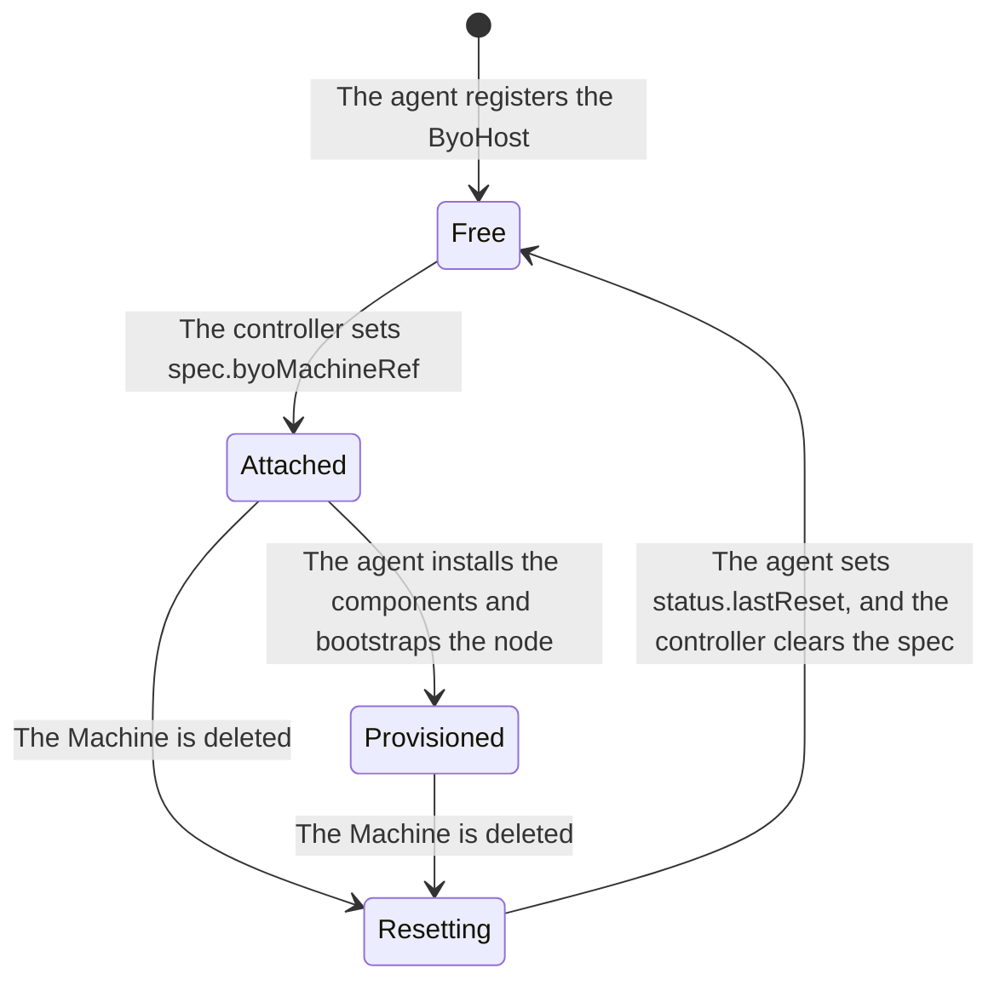

# Host lifecycle

This document describes the states of a host, which fields of its ByoHost the BYOH controller manager and the agent write, how to check the hosts, and what to do when a host is not reset.

## States of a host



1. **Free**: The agent creates the ByoHost of its host, with the labels of its `--label` flags, and reports the host in the status (see [Host registration and permissions](host_registration.md)). `spec.byoMachineRef` is empty.
2. **Attached**: A ByoMachine takes a free ByoHost in its namespace that matches its selector. The controller sets `spec.byoMachineRef` to the ByoMachine and `spec.bootstrapSecret` to the bootstrap data of its Machine, and then `spec.installationSecret` to the scripts that the installer generates.
3. **Provisioned**: The agent installs the Kubernetes components with the install script, unless it runs with `--skip-installation`, and bootstraps the node with kubeadm. The controller sets the provider ID of the Node, and the ByoMachine becomes ready.
4. **Resetting**: When the Machine is deleted, the controller sets `spec.resetRequested`. The agent resets the host: it runs `kubeadm reset`, uninstalls the Kubernetes components that it has installed, and removes the bootstrap sentinel file. It then reports the reset in `status.lastReset`, with the UID in `spec.byoMachineRef`. The controller clears the spec of the ByoHost, and the host is free again.

The deletion of a Machine finishes only after its host is reset: the controller keeps the finalizer of the ByoMachine until then. While it waits, the condition `BYOHostReady` of the ByoMachine is `False` with the reason `WaitingForHostReset`. A rollout that replaces the Machines, or a scale down, therefore waits for the reset of each host. The deletion of a cluster waits for the reset of all its hosts.

The reset runs `kubeadm reset` when kubeadm is on the host: when the agent has installed the Kubernetes components, or when it runs with `--skip-installation`. It runs the uninstall script only when the agent has installed the components. The agent keeps the uninstall script from the installation until the reset, in `uninstall.sh` in its working directory (`/var/lib/byoh-hostagent/uninstall.sh` with the deb package).

## Who writes each field

The controller writes the spec of a ByoHost, and the agent writes the status. BYOH does not write the labels and the annotations of a ByoHost; they are for the administrators.

| Field | Written by | Content |
|---|---|---|
| `metadata.labels` | Administrators. The agent sets the labels of its `--label` flags only when it creates the ByoHost | The labels that the ByoMachineTemplates select the hosts by, such as `role` |
| `metadata.annotations` | Administrators | `cluster.x-k8s.io/paused` stops the agent (see [Pausing a host](#pausing-a-host)) |
| `spec.byoMachineRef` | Controller | The name and the UID of the ByoMachine that the host is attached to. The host is in use while it is set |
| `spec.resetRequested` | Controller | Asks the agent to reset the host, after the Machine is deleted |
| `spec.bootstrapSecret` | Controller | The Secret with the bootstrap data of the Machine |
| `spec.installationSecret` | Controller | The Secret with the install and uninstall scripts |
| `status.conditions` | Agent | The state of the installation, the bootstrap and the reset |
| `status.hostinfo`, `status.network`, `status.agentInfo` | Agent | The host and the agent, reported every time the agent starts |
| `status.lastReset` | Agent | The UID of the ByoMachine that the host was last reset for, and when |

## Checking the hosts

`kubectl get byohosts` shows the ByoMachine that each host is attached to; the column `BYOMACHINE` is empty for a free host.

The conditions of a ByoHost show what the agent is doing, and `kubectl describe byohost <name>` also shows its events:

| Condition | Reason | Meaning |
|---|---|---|
| `K8sNodeBootstrapSucceeded` | `WaitingForByoMachineRef` | The host is free |
| `K8sNodeBootstrapSucceeded` | `BootstrapDataSecretUnavailable` | The host is attached, and the agent waits for `spec.bootstrapSecret` |
| `K8sComponentsInstallationSucceeded` | `K8sInstallationSecretUnavailable` | The agent waits for `spec.installationSecret` |
| `K8sComponentsInstallationSucceeded` | `K8sComponentsInstallationFailed` | The install script failed. The agent tries again |
| `K8sNodeBootstrapSucceeded` | `CleanK8sDirectoriesFailed`, `CloudInitExecutionFailed` | The bootstrap failed. The agent tries again |
| `K8sNodeBootstrapSucceeded` | `K8sNodeResetFailed` | `kubeadm reset`, or the removal of the bootstrap sentinel file, failed in the reset. The message has the error. The agent tries again |
| `K8sComponentsInstallationSucceeded` | `K8sComponentsUninstallationFailed` | The uninstall script failed in the reset. The message has the error. The agent tries again |
| `K8sNodeBootstrapSucceeded`, `K8sComponentsInstallationSucceeded` | `K8sNodeAbsent` | The host has been reset |

## When a host is not reset

When the deletion of a Machine does not finish, check whether the ByoHost of the Machine has `spec.resetRequested`, and whether `status.lastReset.byoMachineUID` is still different from `spec.byoMachineRef.uid`:

```shell
kubectl get byohost <name> -o jsonpath='{.spec.resetRequested} {.spec.byoMachineRef.uid} {.status.lastReset.byoMachineUID}{"\n"}'
```

Then find why the agent does not reset the host, from the conditions and the events of the ByoHost, and from the logs of the agent on the host:

```shell
kubectl describe byohost <name>
sudo journalctl -u byoh-hostagent
```

The agent tries the reset again until it succeeds, so fix the cause on the host, such as the pods that the uninstall script fails for (see [installer](installer.md)). Check that the agent runs, and that it is not paused.

A ByoHost that is attached to a ByoMachine cannot be deleted. When the host cannot be reset, for example because it is broken, stop waiting for it as follows:

1. Remove the finalizer of the ByoMachine. The deletion of the Machine then finishes. The ByoHost stays attached to the deleted ByoMachine with `spec.resetRequested`, so that the host is not used again before it is reset.

   ```shell
   kubectl patch byomachine <name> --type=json -p '[{"op":"remove","path":"/metadata/finalizers"}]'
   ```

2. Reset the host. When the agent of the host runs again, it resets the host for the request, and sets `status.lastReset.byoMachineUID` to `spec.byoMachineRef.uid`. You can also reset the host yourself, or install its OS again.
3. Return the host to the free hosts by clearing the spec of its ByoHost. Do not do this before the host is reset: the next ByoMachine would bootstrap the host over the old node.

   ```shell
   kubectl patch byohost <name> --type=merge -p '{"spec":{"byoMachineRef":null,"resetRequested":null,"bootstrapSecret":null,"installationSecret":null}}'
   ```

   To remove the host for good, delete the ByoHost after this. The agent creates the ByoHost again when it starts, so stop or remove the agent first (see [Stopping and removing the agent](getting_started.md#stopping-and-removing-the-agent)).

## Pausing a host

To stop the agent of a host from acting on its ByoHost, add the annotation `cluster.x-k8s.io/paused` to the ByoHost. The agent then neither provisions nor resets the host until the annotation is removed:

```shell
kubectl annotate byohost <name> cluster.x-k8s.io/paused=
kubectl annotate byohost <name> cluster.x-k8s.io/paused-
```

Pausing a Cluster does not pause its hosts. The controller does not change the ByoHosts while the Cluster is paused, so the agents have nothing new to act on.
