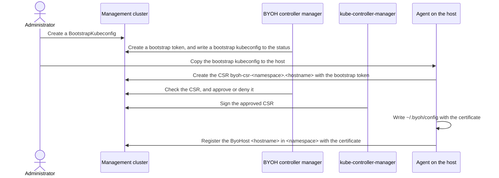

# Host registration and permissions

This document describes how a host joins the management cluster as a ByoHost, what the host and the credentials it uses can do in the management cluster, and how to operate them securely.

The agent runs as root on the host, as it installs the Kubernetes components and runs kubeadm. Whoever controls a host can use everything that the host can access in the management cluster, so read [Current limitations](#current-limitations) before you add hosts that you do not fully trust.

## Overview



## Registering a host

### 1. Create a BootstrapKubeconfig

Create a BootstrapKubeconfig for each host:

```yaml
apiVersion: infrastructure.cluster.x-k8s.io/v1beta1
kind: BootstrapKubeconfig
metadata:
  name: bootstrap-kubeconfig-host1
  namespace: default
spec:
  # The address of the API server of the management cluster that the host can reach.
  apiserver: https://192.168.0.10:6443
  # The CA certificates of the API server, PEM encoded and then base64 encoded,
  # as in certificate-authority-data of a kubeconfig.
  certificate-authority-data: LS0tLS1CRUdJTi...
  # Do not set this, as the host then cannot detect a fake API server.
  # insecure-skip-tls-verify: false
```

The BYOH controller manager creates a bootstrap token for the BootstrapKubeconfig only once, while its status is empty:

- The token is a Secret `bootstrap-token-<token ID>` of the type `bootstrap.kubernetes.io/token` in the namespace `kube-system`.
- It expires 30 minutes after it is created, and it is not created again. When it has expired, create a new BootstrapKubeconfig.
- It is valid for authentication (and for signing, which BYOH does not use), and adds the group `system:bootstrappers:byoh` to the user of the token.

The controller writes a kubeconfig that authenticates with the token to `status.bootstrapKubeconfigData`. Its server and CA are the ones in the spec.

```shell
kubectl get bootstrapkubeconfig bootstrap-kubeconfig-host1 -n default -o=jsonpath='{.status.bootstrapKubeconfigData}' > bootstrap-kubeconfig-host1.conf
```

The token is not bound to a host: anyone who has it can register a host of any name until it expires. Copy the bootstrap kubeconfig only to the host that it is for, and start the agent right away.

### 2. Start the agent with the bootstrap kubeconfig

```shell
byoh-hostagent --bootstrap-kubeconfig bootstrap-kubeconfig-host1.conf
```

With the deb package of the agent, put the bootstrap kubeconfig at `/etc/byoh-hostagent/bootstrap-kubeconfig` and start the service `byoh-hostagent`, which passes the file with `--bootstrap-kubeconfig` (see [Installing the agent on your hosts](getting_started.md#installing-the-agent-on-your-hosts)):

```shell
sudo install -m 0600 bootstrap-kubeconfig-host1.conf /etc/byoh-hostagent/bootstrap-kubeconfig
sudo systemctl enable --now byoh-hostagent
```

The agent uses the bootstrap kubeconfig only when `~/.byoh/config` does not exist; see [Restarting the agent](#restarting-the-agent). It then:

1. generates a private key in the file `byoh-client.key.tmp` in its working directory (mode 0600; `/var/lib/byoh-hostagent` with the package), or reuses the file when it exists;
2. creates a CertificateSigningRequest (CSR) named `byoh-csr-<namespace>.<hostname>` with the bootstrap token, where `<namespace>` is the namespace of `--namespace`:
    - signer `kubernetes.io/kube-apiserver-client`;
    - usage `client auth`;
    - subject `CN=byoh:host:<namespace>:<hostname>`, `O=byoh:hosts`, without subject alternative names;
    - `expirationSeconds` from `--certExpiryDuration`, in seconds (365 days by default);
3. waits up to one hour for the certificate, and exits with an error if it is not issued;
4. writes `~/.byoh/config` (mode 0600) in the home directory of the user that runs it (`/root/.byoh/config` with the package), with the server and the CA of the bootstrap kubeconfig, the certificate and the private key, and removes `byoh-client.key.tmp`.

`<hostname>` is the hostname of the host. It becomes the name of the ByoHost, so it must be a valid name of a Kubernetes object: a lowercase DNS subdomain. It must also be unique in the namespace: a host with the hostname of another host in the same namespace gets the identity `byoh:host:<namespace>:<hostname>` of that host, and takes over its ByoHost. Hosts in different namespaces have different identities, even with the same hostname. Some images, such as Ubuntu for Raspberry Pi, name every host `ubuntu`, so set the hostname of each host before you start its agent.

### 3. The CSR is approved

The API server records who created the CSR in `spec.username` and `spec.groups`. The requester cannot change them. For a bootstrap token, they are `system:bootstrap:<token ID>` and the groups `system:bootstrappers`, `system:bootstrappers:byoh` and `system:authenticated`.

The signer `kubernetes.io/kube-apiserver-client` issues a client certificate of any subject that is approved, so the approver has to check the CSR (see [Kubernetes signers](https://kubernetes.io/docs/reference/access-authn-authz/certificate-signing-requests/#kubernetes-signers)). The ByoAdmission controller of the BYOH controller manager watches the CSRs whose names start with `byoh-csr-`, and approves one only when all of these hold:

- The signer is `kubernetes.io/kube-apiserver-client`.
- The usages are `client auth`, optionally with `digital signature`, or with `digital signature` and `key encipherment`.
- The request is signed with its key.
- The subject has exactly two attributes: the organization `byoh:hosts` and the common name `byoh:host:<namespace>:<name>`, where `<namespace>` is a valid name of a namespace (a DNS label) and `<name>` is a lowercase DNS subdomain.
- The name of the CSR is `byoh-csr-<namespace>.<name>`, for the namespace and the name in the common name.
- The request has no subject alternative names.
- The requester is a bootstrap token of BYOH: its groups include `system:bootstrappers:byoh`, and its username starts with `system:bootstrap:`.

ByoAdmission denies the other CSRs with the reason `ByohCSRInvalid` and a message that tells what failed. It leaves alone the CSRs of the other signers, and the CSRs that are already approved or denied.

ByoAdmission does not check the namespace in the common name against the bootstrap token yet, so any bootstrap token of BYOH can get a certificate for any namespace (see [Current limitations](#current-limitations)).

kube-controller-manager signs an approved CSR. The certificate is valid for `expirationSeconds`, up to the `--cluster-signing-duration` of kube-controller-manager (one year by default).

With the certificate, the API server authenticates the host as the user `byoh:host:<namespace>:<hostname>` in the group `byoh:hosts`.

#### Approving CSRs manually

Set `MANUAL_CSR_APPROVAL` to `enable` to disable ByoAdmission, for example with the clusterctl variable when you install the provider:

```shell
MANUAL_CSR_APPROVAL=enable clusterctl init --infrastructure byoh
```

Then check each CSR as ByoAdmission does before you approve it:

```shell
kubectl get csr
# The requester: a bootstrap token of BYOH that you created for this host.
kubectl get csr byoh-csr-<namespace>.<hostname> -o jsonpath='{.spec.username}{"\n"}{.spec.groups}{"\n"}{.spec.signerName}{"\n"}{.spec.usages}{"\n"}'
# The subject: only O=byoh:hosts and CN=byoh:host:<namespace>:<hostname>, with the namespace where you register
# this host, and no subject alternative names.
kubectl get csr byoh-csr-<namespace>.<hostname> -o jsonpath='{.spec.request}' | base64 -d | openssl req -noout -text
kubectl certificate approve byoh-csr-<namespace>.<hostname>
```

Deny a CSR that you do not expect with `kubectl certificate deny`.

### 4. The agent registers the ByoHost

With the certificate, the agent gets or creates the ByoHost named `<hostname>` in the namespace of `--namespace` (`default` by default), with the labels of `--label`, and reports the network interfaces and the OS of the host in its status. The labels are set only when the ByoHost is created, and the agent cannot change its ByoHost but its status afterwards. To change the labels of a registered host, an administrator edits its ByoHost. The labels of Cluster API and BYOH (with the prefix `cluster.x-k8s.io/` or a subdomain of it, such as `byoh.infrastructure.cluster.x-k8s.io/`) cannot be given with `--label`.

A ByoMachine selects only the ByoHosts in its own namespace, so register the host in the namespace of the cluster that uses it. `clusterctl move` also moves only the objects in the namespace of the cluster.

### Restarting the agent

When `~/.byoh/config` exists, the agent uses it and does not use the bootstrap kubeconfig. It registers the existing ByoHost again.

The identity in the certificate includes the namespace of `--namespace`, so the agent cannot register its host in another namespace with the same certificate: the ByoHost webhook rejects the ByoHost. To change `--namespace` of a registered host, register the host again.

To register the host again from the start, for example after its certificate has expired or to change `--namespace`, stop the agent, remove `~/.byoh/config`, and start the agent with a new bootstrap kubeconfig. With the package:

```shell
sudo systemctl stop byoh-hostagent
sudo rm /root/.byoh/config
sudo install -m 0600 bootstrap-kubeconfig-host1.conf /etc/byoh-hostagent/bootstrap-kubeconfig
sudo systemctl start byoh-hostagent
```

## What each identity can do

The provider installs the following RBAC (`config/rbac`; the names get the prefix `byoh-`). In addition, all authenticated users have the default roles of Kubernetes for authenticated users.

| Identity | User and groups | Permissions |
|---|---|---|
| Bootstrap token of a BootstrapKubeconfig | `system:bootstrap:<token ID>` in `system:bootstrappers` and `system:bootstrappers:byoh` | CertificateSigningRequests: create, get, list and watch (`byoh-csr-creator-clusterrole`) |
| Host | `byoh:host:<namespace>:<hostname>` in `byoh:hosts` | ByoHosts in all namespaces: create, get, list and watch; `byohosts/status`: get, update and patch; events (`events.k8s.io`): create and patch (`byohost-editor-role`). Secrets in all namespaces: get (`secret-reader-clusterrole`) |
| BYOH controller manager | the ServiceAccount `byoh-controller-manager` in `byoh-system` | `manager-role`, which includes all the verbs on Secrets in all namespaces, the resources of BYOH, and the approval of the CSRs of the signer `kubernetes.io/kube-apiserver-client` |

An agent creates the ByoHost of its host, and then writes only its status (see [Host lifecycle](host_lifecycle.md#who-writes-each-field)). The ByoHost webhook checks the creation, the update and the deletion of ByoHosts, and the update of their status:

- A member of `byoh:hosts` can create, and update the status of, only the ByoHost of the namespace and the name in its username `byoh:host:<namespace>:<name>`. The agent of a host cannot create a ByoHost of its name in another namespace, nor update its status.
- It can create the ByoHost with labels, but not with the labels of Cluster API and BYOH, annotations, owner references, finalizers or a spec.
- It cannot update a ByoHost other than its status, and cannot delete ByoHosts. RBAC does not allow them either.
- The requests of the other users, such as the controller manager and the administrators, are left to RBAC.
- Nobody can delete a ByoHost while it is attached to a ByoMachine (`spec.byoMachineRef`). See [When a host is not reset](host_lifecycle.md#when-a-host-is-not-reset) for a host that is not reset.

## Certificate lifetime and renewal

The certificate of a host is valid for `--certExpiryDuration` seconds of the agent (365 days by default), up to the `--cluster-signing-duration` of kube-controller-manager.

The agent renews the certificate only when the environment variable `CERTIFICATE_ROTATION` is `true`. It then checks the certificate every 5 seconds, and when less than 20% of its validity is left, it creates a CSR again with the bootstrap kubeconfig of `--bootstrap-kubeconfig`:

- The bootstrap token of the registration has expired by then, so put a new bootstrap kubeconfig at the same path before the renewal.
- The agent writes the new certificate to `~/.byoh/config`, but the running agent keeps using the certificate that it loaded when it started. Restart the agent after the renewal.

Without the renewal, register the host again before its certificate expires (see [Restarting the agent](#restarting-the-agent)).

## Operating securely

- Create a BootstrapKubeconfig for each host just before you start its agent, and copy its bootstrap kubeconfig only to that host. Remove the file from the host after the registration (`sudo rm /etc/byoh-hostagent/bootstrap-kubeconfig` with the package), unless the agent renews its certificate with it.
- Keep `~/.byoh/config` on the host readable only by root. It contains the private key of the host.
- Delete the BootstrapKubeconfigs that you no longer need, as their status keeps the token. Deleting a BootstrapKubeconfig does not delete its token. An expired token can no longer be used, and the token cleaner of kube-controller-manager deletes it if it is enabled (kubeadm enables it). To revoke a token before it expires, delete its Secret. The token ID is the part of the token before the dot:

  ```shell
  kubectl -n kube-system delete secret bootstrap-token-<token ID>
  ```

- Kubernetes cannot revoke a client certificate. When you remove a host, delete its ByoHost after its Machine is deleted, and remove the kubeconfig and the private key of the host from it (`sudo apt purge byoh-hostagent` with the package removes `/root/.byoh`). The certificate of the host stays valid until it expires, with the permissions of the group `byoh:hosts`. A shorter `--certExpiryDuration` shortens this period. If a host may be compromised, the only ways to stop its certificate earlier are to remove the permissions of the group `byoh:hosts`, which stops all the hosts, or to rotate the CA of the cluster.
- Check the CSRs with `kubectl get csr`. The condition of a denied CSR tells why:

  ```shell
  kubectl get csr byoh-csr-<namespace>.<hostname> -o jsonpath='{.status.conditions}'
  ```

  The agent creates the CSR of the same name again when it restarts, and fails while the denied CSR exists. Delete the CSR after you fix the cause. kube-controller-manager also deletes a denied CSR one hour later.

## Current limitations

The following are known, and are planned to be changed:

- A host can get all the Secrets in all namespaces, and list all the ByoHosts. A compromised host can read the bootstrap data of the other hosts, which their ByoHosts refer to in `spec.bootstrapSecret`. In a self-hosted management cluster, it can also read `<cluster>-kubeconfig`, which is the administrator kubeconfig of the management cluster itself. Planned: let a host read only the Secrets of its own ByoHost.
- A bootstrap token of BYOH can get a certificate of any host name in any namespace, including the names of registered hosts. Planned: bind each bootstrap token to a namespace and a host name for one use, and deny the CSRs for the names of registered hosts.
- The name of the CSR is fixed for each host. Someone who can create CSRs can create `byoh-csr-<namespace>.<hostname>` first, and the host cannot get its certificate until that CSR is removed.
- The renewal of a certificate needs a new bootstrap kubeconfig and a restart of the agent. Planned: renew with the certificate of the host.
