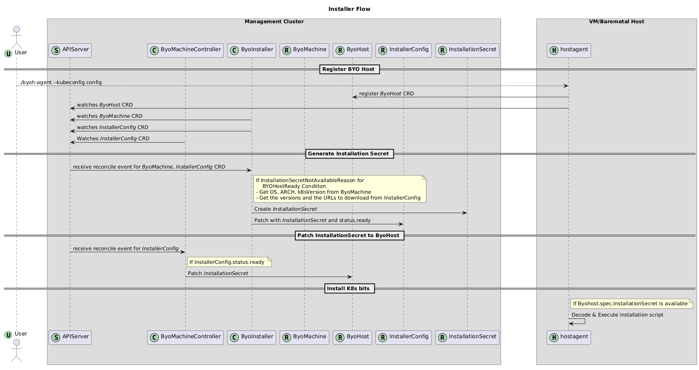

# Installer Implementation
An installer controller is responsible to provide the installation and uninstallation scripts for k8s dependencies, prerequisites and components on each `BYOHost`.
We provide a default installer ([K8sInstallerConfig](https://github.com/superbrothers/cluster-api-provider-bringyourownhost/blob/main/controllers/infrastructure/k8sinstallerconfig_controller.go#L58)) to install the supported upstream k8s.

## Default installer
K8sInstallerConfig installs Kubernetes on the following OSes, on amd64 and arm64:

- Ubuntu 24.04
- Ubuntu 26.04

The install script:

- installs containerd and runc of pinned versions from their releases on GitHub, after it checks their checksums. The versions do not change with the updates of the OS. The script fails when the packages of the OS that conflict with them (`containerd`, `containerd.io`, `docker.io` and `runc`) are installed.
- makes containerd use the systemd cgroup driver with `/etc/containerd/conf.d/99-byoh.toml`. When the host does not have `/etc/containerd/config.toml`, the script generates the default configuration there, which imports `/etc/containerd/conf.d/*.toml`. A `config.toml` of the host must import the directory.
- installs kubelet, kubeadm and kubectl of the version of the Machine from the apt repository of its minor version on pkgs.k8s.io, and holds them. It also installs cri-tools for `crictl`, and generates `/etc/crictl.yaml` to connect it to containerd when the host does not have the file.
- turns off swap and comments out the swap entries in `/etc/fstab`, loads the kernel modules `overlay` and `br_netfilter`, and sets the kernel parameters that Kubernetes needs.

The uninstall script removes the pods that `kubeadm reset` left, and fails when some are left. Then it removes what the install script added: the Kubernetes packages, containerd, runc, their data in `/var/lib/containerd`, the configuration that it generated, and the other files. It also restores the swap entries. A `config.toml` of the host is kept.

The hosts need to reach pkgs.k8s.io, GitHub and the Ubuntu archive. The fields of K8sInstallerConfig change the versions and the places to download from. A mirror must have the same layout as the original: the installer adds `/v<major>.<minor>/deb/` to `kubernetesRepository`, and `/v<version>/<file>` to `containerdReleaseURL` and `runcReleaseURL`.

```yaml
apiVersion: infrastructure.cluster.x-k8s.io/v1beta1
kind: K8sInstallerConfigTemplate
metadata:
  name: ${CLUSTER_NAME}-md-0
spec:
  template:
    spec:
      # The defaults.
      kubernetesRepository: https://pkgs.k8s.io/core:/stable:
      containerdVersion: 2.3.7
      containerdReleaseURL: https://github.com/containerd/containerd/releases/download
      runcVersion: 1.5.2
      runcReleaseURL: https://github.com/opencontainers/runc/releases/download
```

The default version of containerd is an LTS release, and the default version of runc is the one that the containerd release is tested with. `containerdVersion` must be 2.0.0 or later. The releases do not include the systemd unit of containerd, so the script installs the one of the default version from the containerd repository for the other versions too.

The installer does not change the firewall of the hosts. Open the ports that Kubernetes and the CNI plugin use (https://kubernetes.io/docs/reference/networking/ports-and-protocols/).

## Custom installer
If someone wants to implement their own installer controller then they need to follow the following contract:

## Data Types
1. Must create a CustomResourceDefinition `InstallerConfigTemplate` for your `installerConfig` (eg. [K8sInstallerConfigTemplate](https://github.com/superbrothers/cluster-api-provider-bringyourownhost/blob/main/apis/infrastructure/v1beta1/k8sinstallerconfigtemplate_types.go))
1. Must create a CustomResourceDefinition `InstallerConfig` (eg. [K8sInstallerConfig](https://github.com/superbrothers/cluster-api-provider-bringyourownhost/blob/main/apis/infrastructure/v1beta1/k8sinstallerconfig_types.go))
1. Must be namespace-scoped
1. Must have the standard Kubernetes `type metadata` and `object metadata`
1. Must have a `status` field with the following:
    1. Required fields:
        1. `Ready` (boolean): indicates the installation secret has been generated and is ready
        2. `InstallationSecret` (ObjectReference): reference to installation secret
    2. Optional fields:
        1. `failureReason` (string): indicates there is a fatal problem reconciling the installer configuration; meant to be suitable for programmatic interpretation
        2. `failureMessage` (string): indicates there is a fatal problem reconciling the installer configuration; meant to be a more descriptive value than `failureReason`

## Reconcile flow
- If the resource does not have a `ByoMachine` owner, exit the reconciliation
- If the Cluster to which this resource belongs cannot be found, exit the reconciliation
- If `ByoMachine.status.condition.ByoHostReady` reason is not equal to `InstallationSecretNotAvailableReason`, exit the reconciliation
- If `status.ready` is true, exit the reconciliation
- Deterministically generate the name for the installation secret. It must differ from the name of the Machine, which the bootstrap data secret of the Machine has. The default installer uses `<name of the K8sInstallerConfig>-installation`.
- Try to retrieve the Secret with the name from the previous step
  - If it does not exist, generate installation/uninstallation data using `ByoMachine.status.hostinfo` details and create the Secret with the following data:
    - _`install`_ (string): contains installation bash script
    - _`uninstall`_ (string): contains uninstallation bash script
  - The `byoh agent` runs the scripts with bash as they are.
- Set `status.installationSecret` to the generated secret object reference
- Set `status.ready = true`
- Patch the resource to persist changes

## Installer Template
`ByoMachine` refers to an installer template `ByoMachineTemplate.spec.template.spec.installerRef`.
So, `ByoMachine` controller will create the Installer CR using the `InstallerTemplate` for each `ByoMachine`.
